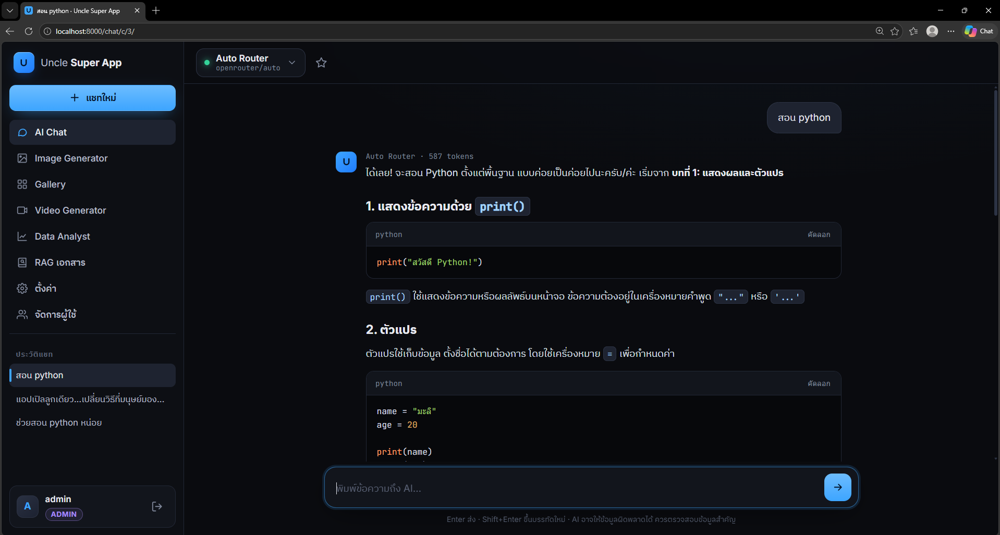
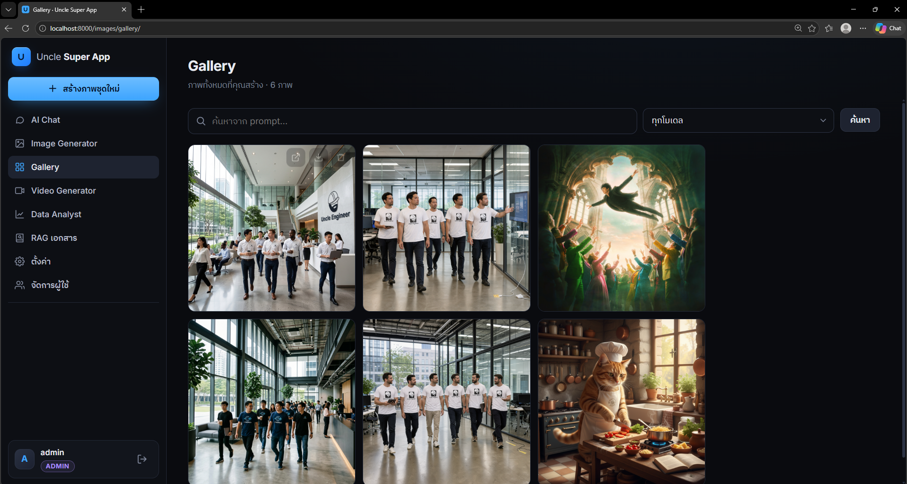
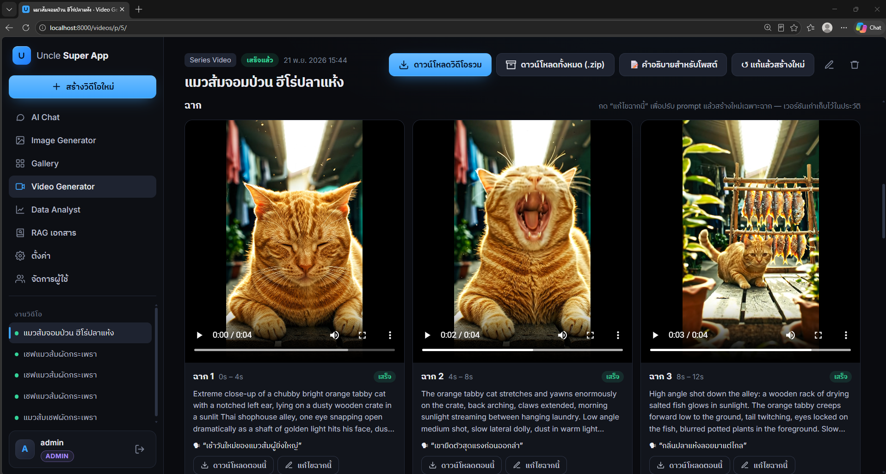
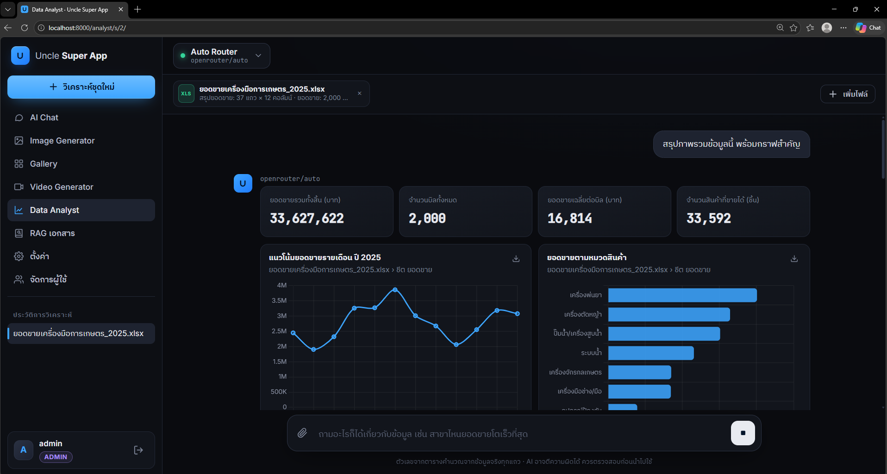
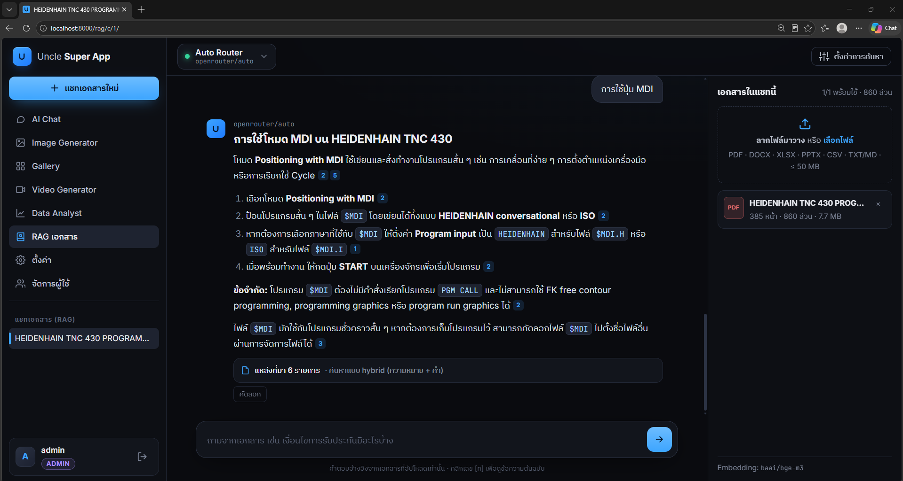
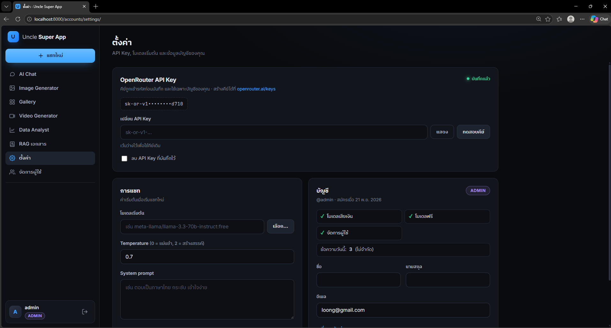

# Uncle Super App

เว็บแอป AI แบบครบชุดที่สร้างด้วย Django ใช้งานผ่าน **OpenRouter** (เข้าถึงโมเดล AI หลายร้อยตัวด้วย API Key เดียว) ธีมมืด ใช้ได้ทั้งคอมพิวเตอร์และมือถือ

> Developed by [Uncle Engineer](https://uncle-engineer.com/)

| เมนู | ทำอะไรได้ |
|---|---|
| **AI Chat** | แชทกับ AI เลือกโมเดลได้ กรองเฉพาะโมเดลฟรี หรือเรียงราคาต่ำ→สูง / สูง→ต่ำ |
| **Image Generator** + **Gallery** | สร้างภาพจาก prompt ใส่ภาพอ้างอิงได้ ปรับสัดส่วนและขนาดภาพได้ เก็บทุกภาพไว้ในแกลเลอรี |
| **Video Generator** | สร้างวิดีโอคลิปเดียว หรือแบบหลายฉาก (หนังสั้น/โฆษณา) สั่งแล้วปิดหน้าเว็บได้ ระบบทำงานเบื้องหลังจนเสร็จ |
| **Data Analyst** | อัปโหลด Excel / CSV / PDF / Word / PowerPoint / รูปภาพ ให้ AI วิเคราะห์ และสรุปข้อมูลจำนวนมากเป็นกราฟ |
| **RAG เอกสาร** | สร้างคลังเอกสารแยกตามแชท แล้วถามคำถามจากเอกสาร AI ตอบพร้อมอ้างอิงแหล่งที่มา |
| **ตั้งค่า / จัดการผู้ใช้** | ผู้ใช้แต่ละคนตั้ง API Key ของตัวเอง แบ่งผู้ใช้เป็น 3 ประเภท (Member / Pro / Admin) Admin เพิ่มผู้ใช้และสร้างลิงก์รีเซ็ตรหัสผ่านได้ |

> ภาพหน้าจอของทุกเมนูอยู่ในหัวข้อ [3. วิธีใช้แต่ละหน้า](#3-วิธีใช้แต่ละหน้า) เรียงตามเมนูด้านซ้ายของแอป

---

## สารบัญ

1. [ติดตั้งและเปิดใช้งาน](#1-ติดตั้งและเปิดใช้งาน)
2. [ตั้งค่าครั้งแรก](#2-ตั้งค่าครั้งแรก)
3. [วิธีใช้แต่ละหน้า](#3-วิธีใช้แต่ละหน้า)
4. [ค่าใช้จ่ายและเคล็ดลับ](#4-ค่าใช้จ่ายและเคล็ดลับ)
5. [แก้ปัญหาที่พบบ่อย](#5-แก้ปัญหาที่พบบ่อย)
6. [การตั้งค่าขั้นสูง](#6-การตั้งค่าขั้นสูง)
7. [สำรองข้อมูล ความปลอดภัย และ Git](#7-สำรองข้อมูล-ความปลอดภัย-และ-git)
8. [นำขึ้นใช้งานจริง (Production)](#8-นำขึ้นใช้งานจริง-production)
9. [โครงสร้างโปรเจกต์](#9-โครงสร้างโปรเจกต์)

---

## 1. ติดตั้งและเปิดใช้งาน

### สิ่งที่ต้องมี
- **Python 3.15** (ใช้ได้ตั้งแต่ 3.10 ขึ้นไป)
- อินเทอร์เน็ต (ตอนติดตั้งครั้งแรก และตอนเรียกใช้ AI)
- บัญชี **OpenRouter** พร้อมเครดิต สมัครได้ที่ https://openrouter.ai (โมเดลแชทฟรีบางตัวใช้ได้โดยไม่ต้องเติมเงิน แต่ภาพและวิดีโอต้องใช้เครดิต)

### 🔰 สำหรับมือใหม่ (Windows) — ทำตามนี้ทีละขั้น

**ขั้นที่ 1: ติดตั้ง Python 3.15** (ทำครั้งเดียว ถ้ามีอยู่แล้วข้ามได้)
1. เข้า https://www.python.org/downloads/release/python-3150/ เลื่อนลงไปที่ **Files** แล้วดาวน์โหลด **Windows installer (64-bit)**
2. เปิดไฟล์ที่ดาวน์โหลด ที่หน้าต่างแรก **ติ๊ก ☑ `Add python.exe to PATH`** (ช่องด้านล่างของหน้าต่าง — **สำคัญมาก ห้ามลืม**)
3. กด **Install Now** รอจนขึ้น *Setup was successful* แล้วกด Close

> ลืมติ๊ก Add to PATH? เปิดไฟล์ติดตั้งอีกครั้ง → **Modify** → Next → ติ๊ก **Add Python to environment variables** → Install
> (ถ้าไม่ได้ติ๊กจริงๆ `run.bat` จะลองใช้คำสั่ง `py` แทนให้ก่อน)

**ขั้นที่ 2: ดาวน์โหลดโปรแกรม**
- ที่หน้า GitHub กดปุ่มสีเขียว **Code → Download ZIP** แล้ว**คลิกขวาที่ไฟล์ ZIP → Extract All…** (ต้องแตกไฟล์ก่อน ห้ามเปิดจากในไฟล์ ZIP)
- แนะนำให้วางโฟลเดอร์ไว้ที่ไม่ซิงก์ OneDrive เช่น `C:\UncleSuperApp`

**ขั้นที่ 3: ดับเบิลคลิก `run.bat`**
- ครั้งแรกจะทำให้อัตโนมัติทั้งหมด: สร้าง `.venv` → ติดตั้งไลบรารี (1–5 นาที) → สร้างฐานข้อมูล → **ถามสร้างบัญชี Admin** (พิมพ์ Username / Email เว้นว่างได้ / Password — ตอนพิมพ์รหัสจะไม่เห็นตัวอักษร เป็นเรื่องปกติ)
- เสร็จแล้วเบราว์เซอร์จะเปิด **http://127.0.0.1:8000** ให้เอง → เข้าสู่ระบบ → ไปที่ **ตั้งค่า** ใส่ OpenRouter API Key (ดูหัวข้อ 2)
- **ห้ามปิดหน้าต่างดำ** ระหว่างใช้งาน (เป็นตัว server และเป็นที่สร้างวิดีโอเบื้องหลัง) จะเลิกใช้ให้กด Ctrl+C หรือปิดหน้าต่าง
- ครั้งต่อไป ดับเบิลคลิก `run.bat` อย่างเดียว เปิดได้ในไม่กี่วินาที

**`run.bat` ตรวจและแนะนำวิธีแก้ให้เอง** เมื่อ: ไม่พบ Python / Python เก่ากว่า 3.10 (มีปุ่มเปิดหน้าดาวน์โหลด) · รันจากในไฟล์ ZIP · วาง run.bat ผิดโฟลเดอร์ · `.venv` เสียหลังย้ายโฟลเดอร์หรืออัปเดต Python (สร้างใหม่ให้) · ติดตั้งไลบรารีไม่ได้เพราะเน็ต · Port 8000 ถูกใช้อยู่ (เปลี่ยนไป 8001 ให้) · ยังไม่มีบัญชี Admin
`create_admin.bat` ใช้สร้างบัญชี Admin เพิ่มภายหลัง

### รันเองด้วยคำสั่ง (ทุก OS / VS Code)
```bash
python -m venv .venv
.venv\Scripts\activate            # macOS/Linux: source .venv/bin/activate
pip install -r requirements.txt
python manage.py migrate
python manage.py createsuperuser  # ครั้งแรกเท่านั้น
python manage.py runserver 0.0.0.0:8000
```

### เปิดจากเครื่องอื่นในวง LAN / มือถือ
รันด้วย `0.0.0.0:8000` (ทั้ง `run.bat` และคำสั่งด้านบนตั้งไว้แล้ว) แล้วเปิด `http://<IP ของเครื่องนี้>:8000` (`run.bat` แสดงที่อยู่นี้ให้ตอนเปิด) ถ้าเปิดไม่ได้ ให้อนุญาต Python ใน Windows Firewall

### ⚠️ ทุกครั้งที่อัปเดตโค้ด
ถ้ามีฟีเจอร์ใหม่ที่เพิ่มตารางหรือแพ็กเกจ ต้องรัน 2 คำสั่งนี้ก่อนเปิด server (ถ้าเปิดด้วย `run.bat` จะทำให้อัตโนมัติ)
```bash
pip install -r requirements.txt
python manage.py migrate
```
ถ้าลืม จะเจอ error **`no such table: ...`**

---

## 2. ตั้งค่าครั้งแรก

1. **เข้าสู่ระบบ** ด้วยบัญชี Admin ที่สร้างไว้
2. ไปที่ **ตั้งค่า** (เมนูซ้าย)
   - **OpenRouter API Key:** สร้างที่ https://openrouter.ai/keys แล้ววางในช่อง กด **"ทดสอบคีย์"** เพื่อดูยอดเครดิต แล้วกด **บันทึก**
     (คีย์ถูกเข้ารหัสก่อนเก็บ และใช้เฉพาะบัญชีของคุณ)
   - **โมเดลเริ่มต้น:** กด "เลือก…" เพื่อเลือกโมเดลแชทที่ใช้บ่อย โมเดลนี้ใช้ในปุ่ม "ให้ AI ช่วยคิด" ทุกหน้าด้วย
   - **System prompt / Temperature:** เช่น "ตอบเป็นภาษาไทย กระชับ เข้าใจง่าย"
3. **เพิ่มผู้ใช้คนอื่น:** Admin กด **+ เพิ่มผู้ใช้** ที่หน้า **จัดการผู้ใช้** (เลือกประเภทได้เลย เว้นรหัสผ่านว่าง = สุ่มให้) หรือให้ผู้ใช้กด **สมัครสมาชิก** เองที่หน้าเข้าสู่ระบบ (จะได้ประเภท *Member* แล้ว Admin เปลี่ยนประเภทภายหลัง)

### ประเภทผู้ใช้

| ประเภท | โมเดลเสียเงิน | ภาพ / วิดีโอ | ข้อความแชทต่อวัน | จัดการผู้ใช้ |
|---|---|---|---|---|
| **Member** (ค่าเริ่มต้น) | ✕ ใช้ได้เฉพาะโมเดลฟรี | ✕ (ยังไม่มีโมเดลฟรี) | 50 | ✕ |
| **Pro** | ✓ | ✓ | ไม่จำกัด | ✕ |
| **Admin** | ✓ | ✓ | ไม่จำกัด | ✓ |

ปรับสิทธิ์ได้ที่ `config/settings.py` → `ROLE_PERMISSIONS`

---

## 3. วิธีใช้แต่ละหน้า

เรียงตามเมนูด้านซ้ายของแอป: AI Chat → Image Generator → Gallery → Video Generator → Data Analyst → RAG เอกสาร → ตั้งค่า / จัดการผู้ใช้

### 💬 AI Chat



1. กดชื่อโมเดลด้านบนเพื่อเปิดหน้าต่างเลือกโมเดล ใช้ปุ่ม **ทั้งหมด / ฟรี / เสียเงิน** เรียง **ราคา ต่ำ→สูง / สูง→ต่ำ** ค้นหาชื่อ หรือกรองตามผู้ให้บริการได้
2. พิมพ์ข้อความ กด **Enter** เพื่อส่ง (**Shift+Enter** = ขึ้นบรรทัดใหม่) กดปุ่ม ■ เพื่อหยุดคำตอบกลางทาง
3. ปุ่ม ⭐ = ตั้งโมเดลนี้เป็นค่าเริ่มต้น · ประวัติแชทอยู่แถบซ้าย (เปลี่ยนชื่อ/ลบได้)

### 🖼️ Image Generator


1. เลือกโมเดลสร้างภาพ (หน้านี้แสดงเฉพาะโมเดลที่สร้างภาพได้) กรองแบบ **"รับภาพอ้างอิงได้"** หรือเรียงตามราคาต่อภาพได้
2. พิมพ์ **prompt** เช่น *"นำโลโก้นี้ไปใส่บนเสื้อยืดของผู้ชายที่ยืนในโรงงาน"*
3. **ภาพอ้างอิง:** ลากวาง / เลือกไฟล์ / กด **Ctrl+V** วางจากคลิปบอร์ด (จำนวนสูงสุดขึ้นกับโมเดล)
4. **Advanced parameters:** สัดส่วนภาพ, ความละเอียด (1K–4K), ขนาด, คุณภาพ, จำนวนภาพ, พื้นหลังโปร่งใส, seed (แสดงเฉพาะค่าที่โมเดลรองรับ)
5. กด **สร้างภาพ** (หรือ **Ctrl+Enter**)
   - บนภาพที่ได้: 🔗 **ใช้เป็นภาพอ้างอิง** (แก้ภาพต่อเนื่อง) · ⬇ ดาวน์โหลด · 🗑 ลบ
   - **"↺ ใช้ prompt และการตั้งค่านี้"** = ทำซ้ำด้วยค่าเดิม

### 🗂️ Gallery



- รวมภาพทั้งหมดที่คุณสร้างจากทุกชุด
- ค้นหาจาก prompt หรือกรองตามโมเดล
- คลิกภาพเพื่อดูขยายพร้อมรายละเอียด · ชี้ที่ภาพจะมีปุ่ม 🔗 ใช้เป็นภาพอ้างอิง / ⬇ ดาวน์โหลด / 🗑 ลบ

### 🎬 Video Generator



#### ⚡ วิธีสร้างวิดีโอที่ง่ายที่สุด (4 ขั้นตอน)
1. เปิดแท็บ **Video Generator** (เมนูซ้าย)
2. พิมพ์ **"ไอเดีย / คำอธิบายวิดีโอ"** เป็นภาษาไทยได้เลย เช่น *แมวส้มจอมป่วน แอบขโมยปลาแห้งในตรอกตึกแถว*
3. กดปุ่ม **"ให้ AI ช่วยคิด Prompt"** (ฝั่งขวา) AI จะเขียน prompt ภาษาอังกฤษที่ละเอียดให้ (กดไอคอน `TH` เพื่อดูคำแปลไทยได้)
4. กดปุ่ม **"สร้างวิดีโอ"** (มุมขวาล่าง)

เสร็จแล้ว! ปิดหน้าเว็บไปทำอย่างอื่นได้ เมื่อวิดีโอเสร็จจะมีแจ้งเตือน แล้วกดดู / ดาวน์โหลดได้จากรายการ **งานวิดีโอ** ที่แถบซ้าย
> ค่าอื่นๆ (โมเดล สัดส่วน ความยาว เสียง) ใช้ค่าเริ่มต้นได้เลย ดูค่าใช้จ่ายโดยประมาณได้ข้างปุ่ม "สร้างวิดีโอ" ก่อนกด

**สั่งแล้วปิดหน้าได้เลย** ระบบเบื้องหลังจะสร้างจนเสร็จ แล้วแจ้งเตือนด้วยกล่องข้อความ, ตัวเลขที่เมนู และการแจ้งเตือนของเบราว์เซอร์ ไม่ว่าคุณจะอยู่หน้าไหน (*server ต้องเปิดอยู่*)

#### ขั้นตอนแบบละเอียด (ปรับแต่งเอง)
1. เลือกโหมดด้านบน: **Single Video** (คลิปเดียว) หรือ **Series Video** (หลายฉาก เช่น 12 ฉาก × 5 วินาที = 60 วินาที)
2. พิมพ์ **ไอเดีย / คำอธิบายวิดีโอ** หรือใช้เมนู **✨ ช่วยคิด**
   - **ขยายไอเดียให้ละเอียด:** จาก "แมวทำกับข้าว" → ได้ตัวละคร ฉาก เรื่องราว อารมณ์ (กด "ย้อนกลับ" ได้)
   - **เสนอไอเดีย 3 แบบ:** คลิกแบบที่ชอบเพื่อใช้
   - **เขียนคำอธิบายสำหรับโพสต์:** ได้ชื่อคลิป, description และแฮชแท็กสำหรับ YouTube / TikTok เลือกภาษาได้ **ไทย / English / ไทย + English** (ระบบจำภาษาที่เลือกล่าสุดไว้) ทุกเวอร์ชันเก็บไว้ในปุ่ม **ประวัติ**
3. เลือก **ประเภทวิดีโอ** (โฆษณาสินค้า, หนังสั้น, Reels ฯลฯ) และ **สไตล์ภาพ**
4. เลือก **โมเดลวิดีโอ** แล้วตั้งค่า **สัดส่วน** (16:9 / 9:16 / 1:1 …), **ความละเอียด**, **ความยาว**
5. **เสียง:** 🔇 เงียบ · 🌿 เสียงบรรยากาศ · 🗣 มีเสียงพูด (เลือก **ไทย** หรือ **English**) ถ้าโมเดลไม่รองรับเสียง ตัวเลือกนี้จะกดไม่ได้
6. *(Series)* **ฉากต่อเนื่อง:** ใช้เฟรมสุดท้ายของฉากก่อนเป็นเฟรมแรกของฉากถัดไป ภาพลื่นกว่าแต่ช้ากว่า · **เพลงประกอบ:** ให้ AI สร้างเพลงแล้วผสมเข้าวิดีโอ ปรับความดังได้
7. *(ไม่บังคับ)* **ภาพเริ่มต้น:** เช่น ภาพสินค้า ใช้เป็นเฟรมแรก
8. **Prompt Studio** (ฝั่งขวา): กด **"ให้ AI ช่วยคิด Prompt"** แล้วตรวจหรือแก้ก่อนสร้างจริง
   - Series จะได้ **Style guide** (ใส่หน้าทุกฉากเพื่อให้ตัวละครเหมือนเดิม) + **บทแต่ละฉาก** + **prompt เพลง**
   - แต่ละฉากมีปุ่ม **✨ AI** ให้ปรับเฉพาะฉาก และปุ่ม ↑ ↓ × สำหรับสลับลำดับหรือลบ
   - 🈯 **ไอคอน `TH`** ข้าง prompt: **กดเพื่อดูคำแปลภาษาไทย** กดซ้ำ / กดที่อื่น / กด Esc / กด × เพื่อปิด prompt ที่เขียนเองจะแปลให้ตอนกดครั้งแรก (แล้วบันทึกไว้)
9. ดูค่าใช้จ่ายโดยประมาณด้านล่าง แล้วกด **สร้างวิดีโอ**

**หน้าผลงาน** (คลิกงานที่แถบซ้าย — ไอคอนหน้าชื่อบอกโหมด: 🎥 Single Video สีฟ้า / 🎞 Series Video สีม่วง จุดสีบอกสถานะ)
- แสดงความคืบหน้าทีละฉาก แล้วเล่นวิดีโอรวมได้เมื่อเสร็จ
- **ดาวน์โหลด:** **วิดีโอรวม** · **ดาวน์โหลดตอนนี้** (ทุกฉาก) · **ดาวน์โหลดทั้งหมด (.zip)** ซึ่งมีวิดีโอรวม, ทุกฉาก, เพลง และ `prompts.txt`
- **แก้ไขฉากนี้:** แก้ prompt หรือบทพูด หรือพิมพ์บอก AI เช่น *"เปลี่ยนเป็นตอนกลางคืน"* แล้วกด **ให้ AI ช่วยคิด** → **สร้างฉากนี้ใหม่**
  ระบบสร้างเฉพาะฉากนั้นแล้วรวมวิดีโอใหม่ให้อัตโนมัติ
- **ประวัติ (n):** คลิปเวอร์ชันเก่าเก็บไว้ทั้งหมด กด **ใช้เวอร์ชันนี้** เพื่อสลับกลับ, ดาวน์โหลด หรือนำ prompt เก่ามาแก้ต่อได้
- **📝 คำอธิบายสำหรับโพสต์:** เขียนจากฉากจริงของวิดีโอ เลือกภาษา ไทย / English / ไทย + English ได้
  - **ประวัติ:** ทุกครั้งที่ AI เขียน หรือกด **💾 บันทึกเวอร์ชันนี้** (หลังแก้ข้อความเอง) จะถูกเก็บไว้ กดปุ่ม **ประวัติ** เพื่อดูทุกเวอร์ชัน (บอกภาษา, AI เขียน/แก้ไขเอง, วันเวลา) คลิกเพื่อนำกลับมาใช้ หรือกด × เพื่อลบ
  - คำอธิบายที่สร้างจากหน้าสร้างวิดีโอ (ก่อนกดสร้าง) ก็มีประวัติแยกไว้ พร้อมบอกไอเดียที่ใช้ตอนนั้น
- **ลองฉากที่ล้มเหลวใหม่** / **↺ แก้แล้วสร้างใหม่** (นำการตั้งค่าเดิมกลับไปที่หน้าสร้าง) / ยกเลิก / ลบ

### 📊 Data Analyst



1. ลากไฟล์มาวางตรงไหนของหน้าก็ได้ หรือกด 📎 รองรับ **Excel (.xlsx), CSV, PDF, Word (.docx), PowerPoint (.pptx), TXT/MD/JSON, รูปภาพ** (≤ 50 MB/ไฟล์ อัปโหลดหลายไฟล์พร้อมกันได้)
2. กดคำถามแนะนำ เช่น **"สรุปภาพรวมข้อมูลนี้ พร้อมกราฟสำคัญ"** หรือพิมพ์ถามเอง เช่น *"สาขาไหนยอดขายโตเร็วที่สุด"*, *"Top 10 สินค้าขายดี"*
3. ผลลัพธ์:
   - **ไฟล์ตาราง:** AI วางแผนว่าจะสรุปอะไร แล้ว**ระบบคำนวณจากข้อมูลจริงทุกแถว** (AI ไม่เดาตัวเลข) → การ์ด KPI, กราฟเส้น/แท่ง/วงกลม และตารางสรุป แล้วตามด้วยบทวิเคราะห์
   - **เอกสาร/รูปภาพ:** สรุป ดึงตัวเลข และวาดกราฟจากตัวเลขในเอกสาร
4. ถามต่อเนื่องได้เหมือนแชท · ปุ่ม ⬇ บนกราฟ = ดาวน์โหลดเป็น PNG
> ระบบหาแถวหัวตารางให้อัตโนมัติ (ข้ามแถวชื่อรายงานด้านบน) และรู้ว่าคอลัมน์ไหนเป็นตัวเลข / วันที่ / ข้อความ · รูปภาพต้องใช้โมเดลที่มีป้าย 👁 vision

### 📚 RAG เอกสาร



1. กด **"แชทเอกสารใหม่"** แล้วอัปโหลดเอกสารที่แผงขวา (PDF, DOCX, XLSX, PPTX, CSV, TXT/MD) ได้หลายไฟล์ แต่ละแชทเป็นคลังเอกสารแยกกัน
2. รอสถานะเป็น **"พร้อมใช้"** (ระบบแบ่งเนื้อหาและทำดัชนีอยู่เบื้องหลัง)
3. พิมพ์คำถาม AI จะตอบ**จากเอกสารเท่านั้น** พร้อมเลขอ้างอิง **[1] [2]** คลิกเลขเพื่อดูข้อความต้นฉบับ ถ้าเอกสารไม่มีคำตอบจะบอกตรงๆ
4. **ตั้งค่าการค้นหา:** เลือกโมเดล embedding (ค่าเริ่มต้น `baai/bge-m3` รองรับภาษาไทย เปลี่ยนแล้วระบบทำดัชนีใหม่ให้) และจำนวนข้อความอ้างอิงต่อคำถาม

> **ควรใช้หน้าไหน?** ต้องการตัวเลขรวม / กราฟจาก Excel → **Data Analyst** · ต้องการค้นข้อมูลจากเอกสารยาวหลายไฟล์ → **RAG**

### ⚙️ ตั้งค่า และ 👥 จัดการผู้ใช้



- **ตั้งค่า** (ทุกคน): ใส่ / เปลี่ยน / ลบ **OpenRouter API Key** แล้วกด **ทดสอบคีย์** เพื่อดูยอดเครดิต · เลือก **โมเดลเริ่มต้น** (ใช้กับปุ่ม "ให้ AI ช่วยคิด" และการแปลไทยด้วย) · ตั้ง Temperature และ System prompt · ดูสิทธิ์และจำนวนข้อความที่ใช้วันนี้ · แก้ชื่อ อีเมล และเปลี่ยนรหัสผ่าน
- **จัดการผู้ใช้** (เฉพาะ Admin): ดูผู้ใช้ทั้งหมด เปลี่ยนประเภท Member / Pro / Admin และปิด / เปิดบัญชี (รายละเอียดสิทธิ์ดูหัวข้อ [ประเภทผู้ใช้](#ประเภทผู้ใช้))
  - **+ เพิ่มผู้ใช้:** กรอกชื่อผู้ใช้ อีเมล ชื่อ และประเภท เว้นรหัสผ่านว่าง = ระบบสุ่มให้ แล้วแสดงข้อความพร้อมส่ง (ที่อยู่เว็บ + ชื่อผู้ใช้ + รหัสผ่านชั่วคราว) ให้คัดลอก หรือกดเปิดโปรแกรมอีเมล — **รหัสที่สุ่มแสดงครั้งเดียว**

#### 🔑 เมื่อผู้ใช้ลืมรหัสผ่าน
1. ผู้ใช้กด **"ลืมรหัสผ่าน?"** ที่หน้าเข้าสู่ระบบ → กรอกชื่อผู้ใช้หรืออีเมล (และช่องทางติดต่อกลับได้) → ระบบแจ้งว่า **"แอดมินจะติดต่อกลับ"**
2. Admin เห็นตัวเลขแจ้งเตือนสีเหลืองที่เมนู **จัดการผู้ใช้** และรายการในกล่อง **คำขอรีเซ็ตรหัสผ่าน**
3. กด **🔑 สร้างลิงก์รีเซ็ต** (หรือปุ่ม **🔑 ลิงก์รีเซ็ตรหัส** ในแถวของผู้ใช้คนไหนก็ได้) → ได้ลิงก์สุ่มยาว 64 ตัวอักษร พร้อมข้อความอีเมลสำเร็จรูป
4. **ส่งให้ผู้ใช้เอง (manual):** กด **เปิดโปรแกรมอีเมล** (เติมผู้รับ หัวเรื่อง และเนื้อความให้แล้ว) หรือ **คัดลอกข้อความ** ไปส่งทาง LINE / แชท
5. ผู้ใช้กดลิงก์ → ตั้งรหัสผ่านใหม่ → เข้าสู่ระบบได้ทันที คำขอจะปิดให้อัตโนมัติ

> - ลิงก์**ใช้ได้ครั้งเดียว** หมดอายุใน **72 ชั่วโมง** (ปรับได้ด้วย `PASSWORD_RESET_LINK_HOURS`) สร้างลิงก์ใหม่จะยกเลิกลิงก์เดิม และกด **ยกเลิกลิงก์** ได้
> - ระบบเก็บเฉพาะ hash ของลิงก์ ตัวลิงก์**แสดงให้แอดมินดูครั้งเดียว** ถ้าปิดหน้าไปแล้วให้สร้างใหม่
> - ⚠️ ถ้าเปิดหน้าจัดการผู้ใช้ด้วย `127.0.0.1` ลิงก์จะเปิดได้แค่เครื่องนี้ → เปิดหน้านี้ผ่าน IP ของเครื่อง (เช่น `http://192.168.1.20:8000`) ก่อนสร้างลิงก์ หรือตั้ง `SITE_URL`
> - หน้า "ลืมรหัสผ่าน" ไม่บอกว่ามีบัญชีนั้นหรือไม่ (กันคนสุ่มเดาชื่อผู้ใช้) และจำกัด 5 คำขอ/ชั่วโมงต่อเครื่อง

---

## 4. ค่าใช้จ่ายและเคล็ดลับ
- ค่าใช้จ่ายทั้งหมดหักจาก**เครดิต OpenRouter ของผู้ใช้แต่ละคน** ดูยอดได้ที่ ตั้งค่า → ทดสอบคีย์
- ก่อนสร้างภาพ/วิดีโอ จะแสดง**ค่าใช้จ่ายโดยประมาณ** (ราคาที่มี ≈ เป็นการประมาณ) ค่าจริงแสดงในประวัติหลังสร้างเสร็จ
- เริ่มทดลองด้วยโมเดลราคาถูก เช่น ภาพ `google/gemini-2.5-flash-image` (~$0.04/ภาพ) · วิดีโอ `google/veo-3.1-lite` 4 วินาที (~$0.20)
- Prompt วิดีโอ**ภาษาอังกฤษ**ได้ผลดีที่สุด ใช้ปุ่ม "ให้ AI ช่วยคิด" แล้วกดไอคอน `TH` เพื่อตรวจความหมายเป็นภาษาไทย
- เสียงพูดภาษาไทยในวิดีโอ: ความชัดขึ้นกับโมเดล (Veo 3.1 / Seedance ทำได้ดี)
- Series ยาวๆ: ลองกับ 2–3 ฉากก่อน ถ้าพอใจค่อยสร้างเต็มเรื่อง และแก้ทีละฉากภายหลังได้

---

## 5. แก้ปัญหาที่พบบ่อย

| อาการ | วิธีแก้ |
|---|---|
| `OperationalError: no such table ...` | ยังไม่ได้ migrate → หยุด server แล้วรัน `python manage.py migrate` |
| `ModuleNotFoundError` (เช่น pypdf, imageio_ffmpeg) | ดับเบิลคลิก `run.bat` (ติดตั้งให้เอง) หรือรัน `pip install -r requirements.txt` ใน `.venv` |
| `'python' is not recognized...` / เปิด Microsoft Store แทน | ยังไม่ได้ติดตั้ง Python หรือไม่ได้ติ๊ก **Add python.exe to PATH** → ดูหัวข้อ 1 "สำหรับมือใหม่" |
| หน้าตา/สีไม่เปลี่ยนหลังอัปเดต | ปกติระบบโหลด CSS/JS ใหม่ให้เอง ถ้ายังไม่เปลี่ยน กด **Ctrl+F5** |
| ไอคอน `TH` ขึ้น "แปลไม่สำเร็จ" | ข้อความจะบอกสาเหตุและชื่อโมเดลที่ใช้แปล (= โมเดลเริ่มต้นในหน้าตั้งค่า) ถ้าเป็นโมเดลฟรีที่ติด rate limit ให้เปลี่ยนเป็นโมเดลอื่น แล้วกด "ลองอีกครั้ง" |
| "API Key ไม่ถูกต้อง" (401) | ตรวจคีย์ที่หน้า ตั้งค่า → ทดสอบคีย์ |
| "เครดิต OpenRouter ไม่พอ" (402) | เติมเครดิตที่ openrouter.ai หรือเลือกโมเดลฟรี |
| Rate limit (429) | รอสักครู่ หรือเปลี่ยนโมเดล (โมเดลฟรีมักถูกจำกัดบ่อย) |
| วิดีโอค้างที่ "รอคิว" / "กำลังสร้าง" | server ต้องเปิดอยู่ (worker ทำงานใน `runserver`) ถ้าปิดไปแล้ว เปิดใหม่ระบบจะทำต่อเอง |
| "ไม่พบ ffmpeg" ตอนรวมคลิป | `pip install imageio-ffmpeg` หรือกำหนด `FFMPEG_BINARY` ให้ชี้ไปที่ ffmpeg.exe |
| `database is locked` | ปิด server ที่เปิดซ้อนกันอยู่ (เปิดได้ทีละตัว) |
| อ่าน PDF ไม่ได้ / ไม่มีข้อความ | PDF เป็นภาพสแกน → แปลงเป็นรูปภาพแล้วใช้ Data Analyst |
| ไฟล์ .xls / .doc / .ppt | บันทึกเป็น .xlsx / .docx / .pptx ก่อน |
| Port 8000 ถูกใช้แล้ว | `python manage.py runserver 0.0.0.0:8001` |
| Member ใช้ภาพ/วิดีโอไม่ได้ | ไม่มีโมเดลฟรีสำหรับภาพ/วิดีโอ → Admin อัปเกรดเป็น Pro |
| API Key หายหมดหลังย้ายเครื่อง | ต้องคัดลอก `secret_key.txt` ไปด้วย (ดูหัวข้อ 7) |
| Admin ลืมรหัสผ่านของตัวเอง | ให้ Admin คนอื่นสร้างลิงก์รีเซ็ตให้ หรือรัน `.venv\Scripts\python.exe manage.py changepassword <ชื่อผู้ใช้>` |
| ลิงก์รีเซ็ตเปิดไม่ได้บนเครื่องผู้ใช้ | ลิงก์ขึ้นต้นด้วย `127.0.0.1` → สร้างใหม่โดยเปิดหน้าจัดการผู้ใช้ผ่าน IP ของเครื่อง หรือตั้ง `SITE_URL` |

---

## 6. การตั้งค่าขั้นสูง

ตั้งผ่าน **environment variable** ได้ (ไม่ต้องแก้โค้ด):

| ตัวแปร | ค่าเริ่มต้น | ความหมาย |
|---|---|---|
| `DJANGO_SECRET_KEY` | อ่านจาก `secret_key.txt` | กุญแจของระบบ (ใช้เข้ารหัส API Key) |
| `DJANGO_DEBUG` | `1` | ตั้ง `0` เมื่อใช้งานจริง |
| `DJANGO_ALLOWED_HOSTS` | `*` | โดเมน/IP ที่อนุญาต คั่นด้วย `,` |
| `DJANGO_CSRF_TRUSTED_ORIGINS` | – | เช่น `https://app.example.com` |
| `OPENROUTER_BASE_URL` | `https://openrouter.ai/api/v1` | |
| `VIDEO_WORKER_AUTOSTART` | `1` | เริ่ม worker วิดีโอพร้อม `runserver` |
| `VIDEO_POLL_SECONDS` | `20` | ถามสถานะงานวิดีโอทุกกี่วินาที |
| `FFMPEG_BINARY` | – | path ของ ffmpeg (ถ้าไม่ใช้ของ imageio-ffmpeg) |
| `SITE_URL` | – | ที่อยู่เว็บที่ผู้ใช้เข้าถึงได้ ใช้ในลิงก์รีเซ็ตรหัสผ่าน เช่น `http://192.168.1.20:8000` |
| `PASSWORD_RESET_LINK_HOURS` | `72` | อายุลิงก์รีเซ็ตรหัสผ่าน (ชั่วโมง) |

ค่าอื่นๆ ใน `config/settings.py`: `ROLE_PERMISSIONS`, `CHAT_HISTORY_LIMIT`, `IMAGE_REF_MAX_BYTES`, `VIDEO_MAX_CONCURRENT`, `VIDEO_MAX_SCENES`, `DOC_MAX_UPLOAD_MB`, `ANALYST_CONTEXT_CHARS`, `RAG_DEFAULT_EMBED_MODEL`, `RAG_CHUNK_CHARS`, `RAG_TOP_K`

Django admin ดั้งเดิมอยู่ที่ `/django-admin/`

---

## 7. สำรองข้อมูล ความปลอดภัย และ Git

**สำรองข้อมูล:** ปิด server แล้วคัดลอก 3 อย่างนี้ไปพร้อมกัน
- `db.sqlite3` (รวม `db.sqlite3-wal`, `db.sqlite3-shm` ถ้ามี)
- โฟลเดอร์ `media/` (ภาพ วิดีโอ ไฟล์ที่อัปโหลด)
- `secret_key.txt` ⚠️ ถ้าไฟล์นี้หายหรือเปลี่ยน API Key ที่บันทึกไว้ทั้งหมดจะถอดรหัสไม่ได้ ผู้ใช้ต้องใส่ใหม่

**GitHub:** https://github.com/UncleLabsBlacksmith/UncleSuperApp
ดับเบิลคลิก **`push_github.bat`** เพื่อ commit และ push ขึ้น GitHub (ต้องมี [Git for Windows](https://git-scm.com/download/win) ครั้งแรกจะมีหน้าต่างให้ล็อกอิน GitHub) ใช้ไฟล์เดิมนี้ push ซ้ำได้ทุกครั้งที่แก้โค้ด

**Git:** โปรเจกต์มีไฟล์ **`.gitignore`** อยู่แล้ว (Windows Explorer อาจซ่อนไฟล์ที่ขึ้นต้นด้วยจุด) ไฟล์นี้กันไม่ให้ไฟล์เหล่านี้ขึ้น Git:
`.venv/`, `__pycache__/`, `db.sqlite3*`, `secret_key.txt`, `.env`, `media/`, `staticfiles/`, `_to_delete/`, ไฟล์ log และไฟล์ของ editor/OS
```bash
git init
git add .
git commit -m "Uncle Super App"
```
> ไฟล์เอกสาร (.xlsx .csv .pdf .docx .pptx) ที่วางไว้ที่**ชั้นบนสุด**ของโฟลเดอร์โปรเจกต์จะไม่ถูก commit เพราะ repo เป็น public ถ้ามีไฟล์ส่วนตัวชนิดอื่น ให้เพิ่มชื่อไฟล์ใน `.gitignore` ก่อน push

---

## 8. นำขึ้นใช้งานจริง (Production)
`runserver` เหมาะกับใช้ในเครื่องหรือในวง LAN ถ้าจะเปิดให้คนนอกใช้:
1. ตั้ง `DJANGO_DEBUG=0`, `DJANGO_ALLOWED_HOSTS`, `DJANGO_CSRF_TRUSTED_ORIGINS`
2. `python manage.py collectstatic`
3. รันด้วย web server จริง เช่น `pip install waitress` → `waitress-serve --port=8000 config.wsgi:application` แล้ววางหลัง nginx หรือ Caddy พร้อม HTTPS
4. ตั้ง `VIDEO_WORKER_AUTOSTART=0` แล้วรัน worker วิดีโอแยกอีก process: `python manage.py run_video_worker`

---

## 9. โครงสร้างโปรเจกต์
```
config/          settings.py (ตั้งค่า + ROLE_PERMISSIONS), urls.py
accounts/        ผู้ใช้ ประเภทผู้ใช้ API Key (เข้ารหัส) ตั้งค่า จัดการผู้ใช้
chat/            AI Chat + OpenRouter client (openrouter.py)
imagegen/        Image Generator + Gallery (client.py = OpenRouter Image API)
videogen/        Video Generator — client.py (Video API, AI ช่วยคิด, แปลไทย), worker.py (งานเบื้องหลัง),
                 media.py (ffmpeg รวมคลิป/เพลง), management/commands/run_video_worker.py
analyst/         Data Analyst — engine.py (AI วางแผน → คำนวณจริง → สรุป)
rag/             RAG — indexer.py (แบ่งเนื้อหา + embedding เบื้องหลัง), search.py (hybrid search)
docparse/        อ่านไฟล์ PDF/Excel/Word/PowerPoint/CSV (extract.py) + engine สรุปตาราง/กราฟ (tables.py)
templates/       หน้าเว็บ (Django templates)
static/css/      app.css — ธีมทั้งหมด (สีหลักแก้ที่ตัวแปร --accent ด้านบนไฟล์)
static/js/       chat.js, images.js, videos.js, analyst.js, rag.js, models.js, convo.js, settings.js
static/vendor/   marked, DOMPurify, highlight.js, Chart.js (ไม่ต้องพึ่ง CDN)
media/           ไฟล์ที่ผู้ใช้อัปโหลดและผลลัพธ์ (สร้างอัตโนมัติ)
run.bat          เปิดใช้งานบน Windows (ติดตั้ง + migrate + runserver)
create_admin.bat สร้างบัญชี Admin
push_github.bat  commit + push ขึ้น GitHub
```

**ไลบรารีที่ใช้:** Django, requests, cryptography, imageio-ffmpeg, pypdf, openpyxl (ทั้งหมดติดตั้งผ่าน `requirements.txt`)

---

## 🎓 อยากทำวิดีโอด้วย AI แบบครบวงจร? — คอร์ส AI Video Production Pipeline 101

**Uncle Super App สร้างวิดีโอได้แล้ว… แต่จะเปลี่ยนไอเดียให้เป็นคลิปที่คนดูจริงบน YouTube ได้อย่างไร?**

คอร์ส **AI Video Production Pipeline 101** โดย **ลุงวิศวกร สอนคำนวณ (Uncle Engineer)** สอนการผลิตวิดีโอด้วย AI ทั้งสายพาน ตั้งแต่ **หาไอเดีย → เขียนบท → สร้างภาพ/คลิป/เสียงด้วย AI → ตัดต่อ → ทำปกและคำอธิบาย → อัปโหลดและตั้งเวลาลง YouTube → อ่านผล Analytics** แล้วต่อทุกขั้นให้เป็นระบบเดียวที่ใช้ซ้ำได้ทุกคลิป

**สิ่งที่จะได้เรียน (10 EP + Extra)**
- วางแผนช่อง และออกแบบ Pipeline ของตัวเอง
- **Computer Use** สั่ง AI ให้ใช้งานโปรแกรมอย่าง CapCut แทนเรา
- หาไอเดียด้วย **YouTube Data API** และทำคลังหัวข้อ 20 เรื่อง
- เขียนบท, Shot list และ Storyboard
- สร้างภาพ คลิป และเสียงด้วย AI (Text-to-Video / Image-to-Video)
- ตัดต่อด้วย **CapCut** และแบบอัตโนมัติด้วย **Python + FFmpeg**
- กำกับจังหวะ เสียง ซับไตเติล แบรนด์ และแตกเป็นคลิปสั้น
- ทำชื่อคลิป คำอธิบาย และ Thumbnail
- อัปโหลดและตั้งเวลาผ่าน **YouTube API (OAuth)** แล้ววัดผลด้วย YouTube Analytics
- ⭐ **Extra EP: สร้างเว็บ AI Video Generator ด้วย OpenRouter API** แนวเดียวกับหน้า Video Generator ในแอปนี้

**สิ่งที่จะได้กลับไป:** วิดีโอหลัก 1–3 นาที + คลิปสั้นของคุณเอง, โปรเจกต์ CapCut ที่แก้ต่อได้, คลังไอเดีย 20 หัวข้อพร้อมปฏิทินคอนเทนต์, ชุด Prompt/Instruction ทุกขั้นตอน, Template อัปโหลด YouTube API และคู่มือ Workflow ที่ใช้ซ้ำได้

**เหมาะกับ:** Content Creator, นักการตลาด, เจ้าของธุรกิจ และมือใหม่ — **ไม่ต้องมีพื้นฐานเขียนโค้ด**

**รูปแบบ:** ไลฟ์สอนออนไลน์ในกลุ่ม Facebook ทุกวันอาทิตย์ 13:00–15:00 น. รวม 10 สัปดาห์ (~20 ชั่วโมง) **ดูย้อนหลังได้หลังจบไลฟ์**

👉 **ดูรายละเอียด ราคา และสมัครเรียน:** https://uncle-engineer.com/course/ai-video-pipeline-101/
💬 สอบถาม: Facebook เพจ **ลุงวิศวกร สอนคำนวณ** · LINE **@uncleengineer**
